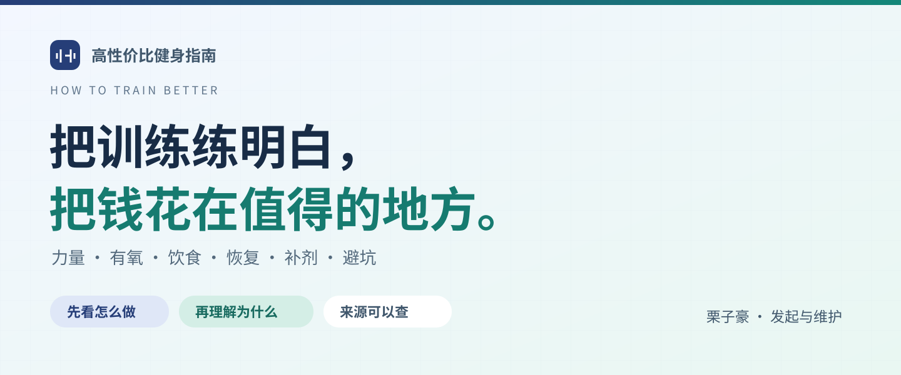

<div align="center">



# 高性价比健身指南

**How to Train Better · v1.0.0**

把训练、饮食和恢复想明白。先看怎么做，再理解为什么。

### [打开在线检索页](https://bel1eff-0228.github.io/How-to-Train-Better/) · [让 AI 查指南回答（Skill）](skills/train-better-guide/README.md)

栗子豪 · 发起与维护

</div>

---

面向刚开始增肌减脂，以及已有基础、希望继续进步的成年训练者。每条先给直接建议，再讲方法、例子、调整条件和来源。

<!-- STATS:START -->
**8 章 · 100 条 · 83 个来源 · A 5 / B 72 / C 23**
<!-- STATS:END -->

> **v1.0.0 更新**：合并局部减脂问答，新增固定器械入门与健身房选择，统一梳理新手易懂的表达。在线站点和下载文件以实际部署版本为准。

## 阅读与下载

| 入口 | 从这里开始 |
| --- | --- |
| **在线** | [打开检索页](https://bel1eff-0228.github.io/How-to-Train-Better/) · 搜索问题、收藏条目、保存阅读进度 |
| **下载** | [PDF / 离线读者包 / Skill](https://github.com/Bel1eff-0228/How-to-Train-Better/releases/latest) · PDF直接阅读，`readers` 包解压后打开 `HowToTrainBetter.html` |
| **AI 问答** | [安装与使用 Skill](skills/train-better-guide/README.md) · 在支持技能的助手里，先查条目再回答 |
| **查阅** | [章节目录](#按问题阅读) · [阅读说明](docs/阅读说明.md) · [来源核验](docs/核验记录.md) |
| **交流** | [纠错与建议](https://github.com/Bel1eff-0228/How-to-Train-Better/issues) · 抖音搜索 **715476895**（🌰荔枝豪） |

不用从头读到尾。先找到眼前的问题，试着应用一条建议，再观察和调整。在线与离线的阅读记录分别保存在浏览器，可用阅读备份迁移。

## 按问题阅读

| 主题 | 你可以查什么 |
| --- | --- |
| [01 · 力量训练](book/01-先把力量练起来.md) | 固定器械入门、组次、重量、如何进步、新手全身示例 |
| [02 · 有氧运动](book/02-把有氧做明白.md) | 快走与跑步、强度、顺序、手表热量 |
| [03 · 饮食](book/03-吃够需要的少走弯路.md) | 热量、蛋白质、外食、补水与食物选择 |
| [04 · 恢复](book/04-恢复好才能接着练.md) | 酸痛、睡眠、减量、停练后怎么回来 |
| [05 · 省钱与避坑](book/05-别把钱和精力花错地方.md) | 局部减脂、体重停滞、选健身房、器材与私教 |
| [06 · 补剂](book/06-补剂先看用途再谈值不值得.md) | 适用人群、推荐度、乳清与酵母蛋白比较 |
| [07 · 进阶训练](book/07-练过一年后把训练变量想清楚.md) | RIR、RPE、TUT、肌肥大、训练量与平台期 |
| [08 · 身体不适](book/08-练着不舒服先这样处理.md) | 抽筋、关节不适、头晕、感冒能否训练 |

## 这份指南怎么判断建议

- **证据等级**：A / B / C 表示依据的支持程度，C 主要是实践建议或推断；不等于医学认证。
- **性价比**：结合目标、花钱、时间与坚持成本的编辑判断，不能替代证据。
- **补剂推荐度**：表示购买优先级，与证据等级不同；A 不代表人人必须买。
- **来源可追溯**：每条附来源与核验日期，区分摘要、全文和机构页面。

详见 [阅读说明](docs/阅读说明.md) · [来源核验](docs/核验记录.md) · [条目与来源对照](docs/引用对照.md)。

通用知识与示例适用于一般成年健身者，不代替个体医疗评估、伤病诊断或康复处方。重要停止条件与求助信号请优先阅读。

新版内容见 [v1.0.0 更新说明](docs/v1.0更新说明.md)。

## 反馈与更新

遇到错误或看不懂的地方，可在条目下点击“反馈这条”，或到 [Issues](https://github.com/Bel1eff-0228/How-to-Train-Better/issues) 写下**条目编号、原句和具体疑问**。请勿公开个人病史等隐私信息。

维护记录见 [更新日志](CHANGELOG.md)。想参与维护，先看 [贡献说明](CONTRIBUTING.md) 和 [首次发布与更新指南](docs/首次发布指南.md)。

<details>
<summary>维护者：构建、发布与版本管理</summary>

正文只维护在 `book/`。网页、PDF与独立技能包从同一份正文生成。

```sh
npm run build
npm test
```

Windows 完整打包使用 `tools/release.ps1`，依赖见 [PDF构建说明](docs/PDF构建说明.md)。本轮操作见 [v1.0 更新说明](docs/v1.0更新说明.md) 和 [GitHub 更新步骤](docs/v1.0-GitHub更新步骤.md)；另有 [版本管理](docs/版本管理.md)、[案例模板](docs/案例整理模板.md) 和 [月度维护](docs/月度维护.md)。

</details>

## 来源与许可

结构、阅读界面和部分解析／离线构建思路改编自 [高性价比人生指南 HowToLiveBetter](https://github.com/eternity4719/HowToLiveBetter)，作者 eternity4719；参考的是用户提供的 ZIP 快照，于 2026-10-01 读取，未声称与上游最新提交一致。

本项目替换了主题内容、评价标准、筛选维度及技能行为，移除了原项目的广告、捐赠入口和统计；当前作者另行提供自愿赞赏入口。未获得原作者对健身结论的背书。

原创正文与技能文档按 [CC BY-NC 4.0](https://creativecommons.org/licenses/by-nc/4.0/deed.zh-hans) 允许署名的非商业分享和改编，商业使用需另获许可。新版统一署名：**栗子豪**；作品名保留**高性价比健身指南（How to Train Better）**；请附许可链接、标明修改，完整法律文本见 [LICENSE](LICENSE)。代码继续按 [MIT](LICENSE-CODE) 提供，上游与第三方材料保持原权利，不能把整包统一理解为 NC。

完整的 [材料与许可对照](licenses/README.md)、[改编来源](docs/来源说明.md) 及 [创作与授权记录](docs/创作与授权记录.md) 均随项目提供；离线文件内也有许可范围与完整 CC／MIT 声明。v0.3 的完整快照和原许可已保留，不改写历史或声称撤销既有许可。记录有助于保存依据，不等于版权登记或防盗保证。


<details>
<summary>关注栗子豪 · 自愿支持维护</summary>

## 关注作者

我是栗子豪，抖音昵称为 **🌰荔枝豪**，抖音号 **715476895**。欢迎关注我的训练分享、教学思考与指南更新。

用抖音扫一扫下方主页码；同一部手机可保存图片后，在抖音扫一扫中从相册识别，也可以直接搜索抖音号。


## 自愿赞赏

如果这份指南对你有帮助，欢迎用微信扫描下方赞赏码，支持后续整理与维护。是否赞赏、赞赏多少都由你决定，不影响任何内容的阅读、下载与使用。

赞赏不代表购买私教服务，也不改变本项目许可；内容建议与补剂推荐不会因赞赏而调整。


赞赏页显示的昵称为「藤原とうふ店」，对应作者提供的这张赞赏码。感谢你的阅读、反馈与支持。

</details>
